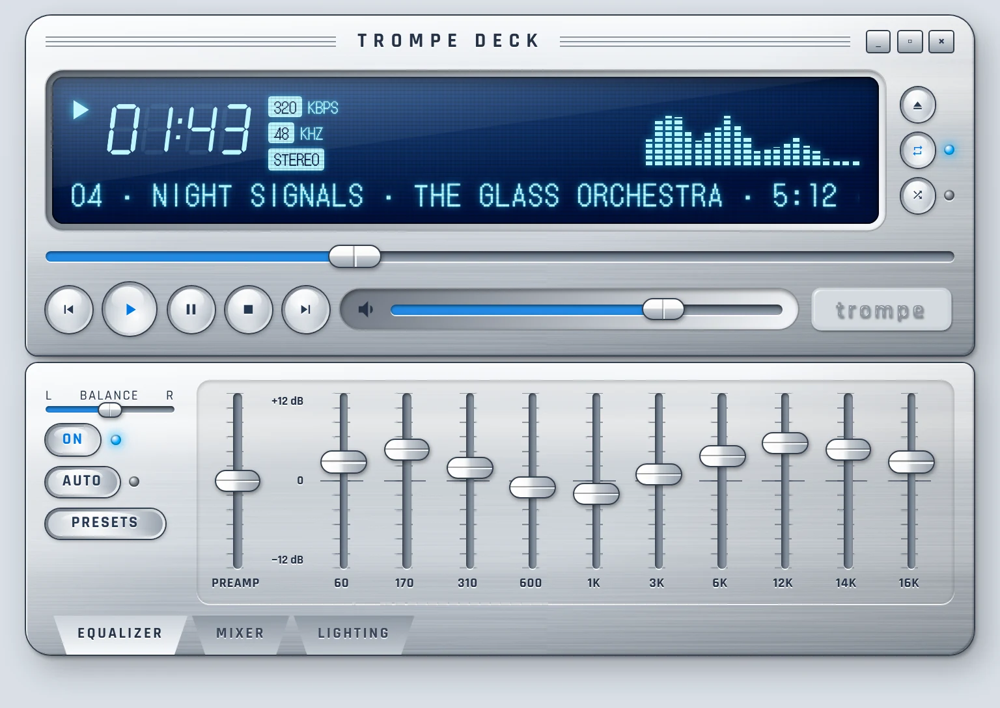
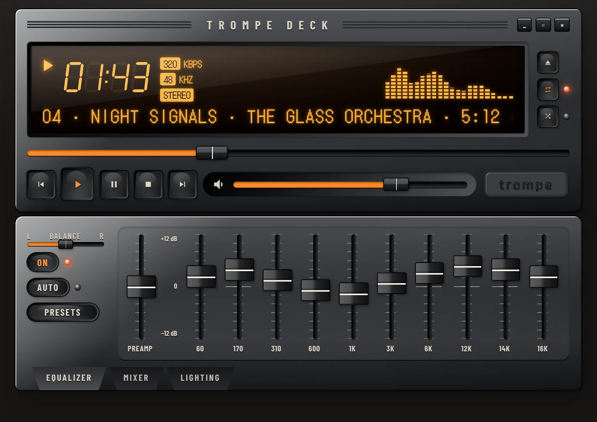
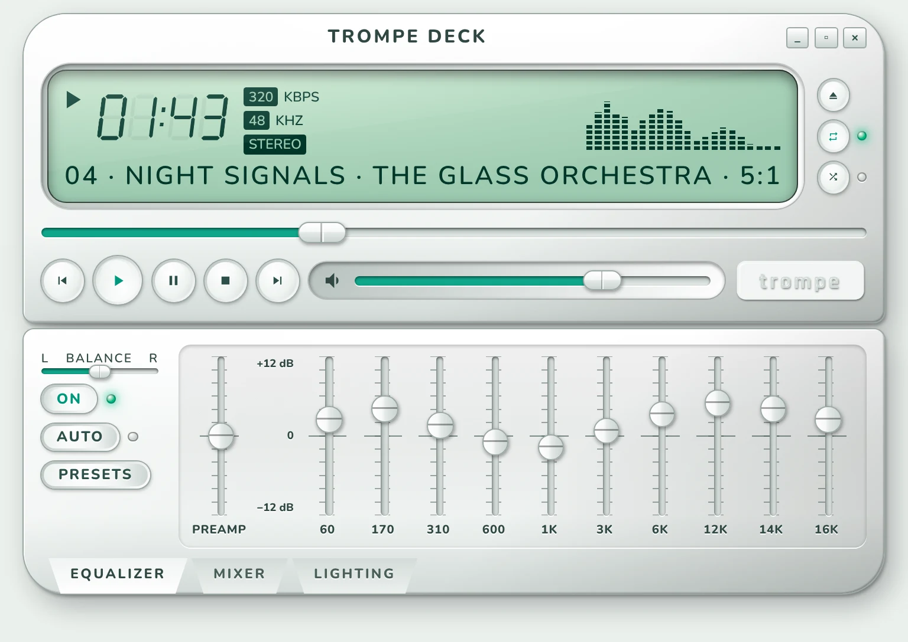
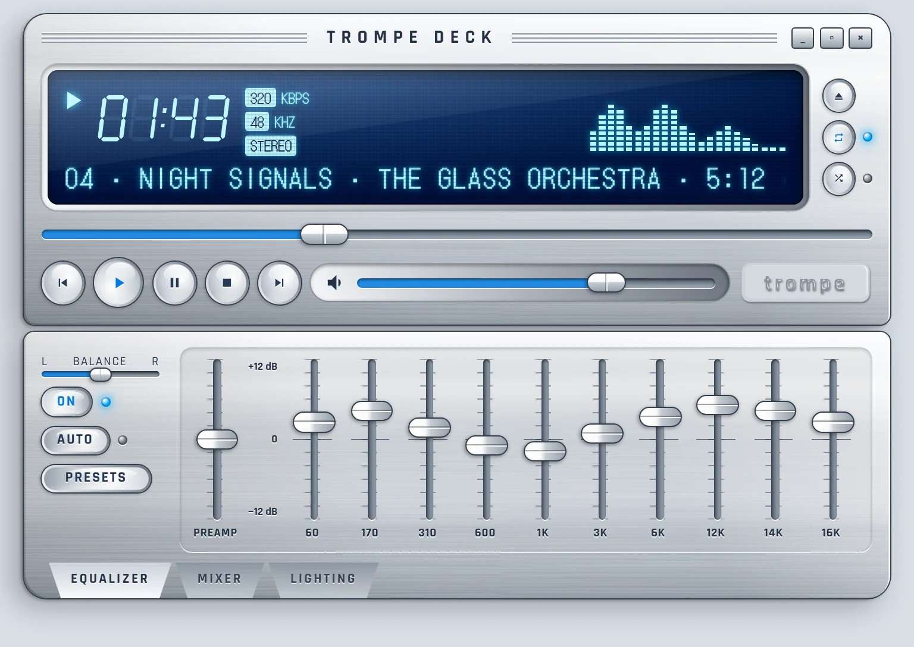
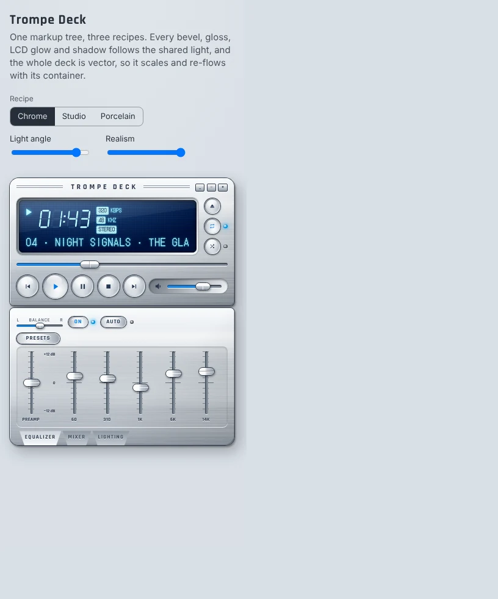

# Trompe design direction

Status: proposal, revision 2 (2026-11-14). Owner: research thread. Consumers: the core foundation package, skin authors and every component author, human or agent.

Revision 2 raises the ceiling. Trompe is not one tasteful "modern tactile" look. It is a rendering system for physical interfaces that can reach hardware-grade realism (brushed and polished metal, glossy domes, glowing LCDs, faders with machined caps) and lets agents and people compose **their own** styles on top of it. Subtle depth is still available, as the low end of the same dial.

Naming note: the code calls these **skins** (`skins/<name>.skin.json`, built to `trompe/skins.css`, applied with `data-tr-skin`). The foundation package ships five: studio, chrome, heritage, soft, aurora. The prototypes below predate that and are illustrations, not the shipped skins.

Two working prototypes back this document:

- [`prototypes/hifi-deck.html`](prototypes/hifi-deck.html): an original media-player deck rendered in pure CSS + SVG, with three skins on one markup tree, a movable light and a realism dial. It re-flows down to phone width.
- [`prototypes/light-model.html`](prototypes/light-model.html): the light and depth math in isolation.

| Chrome | Studio | Porcelain |
|---|---|---|
|  |  |  |

The three looks share every element and every line of component CSS. Only skin tokens differ: palette, material, geometry (dome vs square keys, pill vs fader caps), typography, display type (dot-matrix LCD, amber VFD, reflective e-paper style) and texture.

## TL;DR: the decisions

1. **Trompe is a renderer plus skins, not a style.** Components draw a fixed stack of physical layers. A *skin* fills those layers with values. Built-in skins are examples; agents are expected to write new ones from a plain-language brief.
2. **Fidelity ceiling is hardware-grade.** At `realism="real"` a surface carries up to nine layers: drop shadow, socket, outer line, bevel lip, face, texture, environment reflection, specular gloss and bounce light. Displays add segments, ghost segments, pixel grid, glow and cover-glass reflection.
3. **One light per scene** (`--tr-light-angle`, `--tr-light-elevation`) drives every shadow, rim, gloss position, socket gradient and even SVG lighting filters, so a whole interface agrees on where the light is.
4. **Three rendering tiers.** Tier 1 CSS (always), tier 2 SVG lighting/displacement filters (small static elements), tier 3 GPU (WebGL2/WebGPU, opt-in hero surfaces with CSS fallback). Budgets are enforced by `trompe check`.
5. **Vector and responsive by construction.** Geometry is in `em` off a container-query scale, so a panel stays crisp at any size and pixel density; container queries re-flow it (not just shrink it) at narrow widths.
6. **Real controls under every skin.** Sliders, faders and knobs implement the ARIA slider pattern with full keyboard support, toggles are buttons with `aria-pressed` plus an LED as the second cue, displays have text alternatives. Realism never costs accessibility.
7. **Stack and names are unchanged from revision 1** and already adopted by the foundation work: Lit 3 + strict TypeScript, DTCG 2025.10 tokens, `tr-*` elements, `--tr-*` variables, `material` / `depth` / `realism` / `tone` / `size` attributes, native `input`/`change` events.

---

## 1. What "high fidelity" takes: the layer stack

Studying 2000s hardware-style skins (the fidelity bar we were given) and modern pro-audio and industrial products, convincing realism comes from many cheap, consistent layers, not from one expensive effect. Every Trompe surface is drawn as this ordered stack. Each layer is a named skin slot; a skin may leave any slot empty.

| # | Layer | What it simulates | CSS technique (tier 1) |
|---|---|---|---|
| 1 | **Cast shadow** | Contact + key + ambient shadow on the surface below | 2-3 `box-shadow`s, offsets from `sin()`/`cos()` of the light angle, `pow(depth, 1.6)` growth |
| 2 | **Socket** | The hole milled into the chassis that a key sits in; lit on its far wall | Gradient border via `background: face padding-box, socket border-box` with the gradient at `light + 180deg` |
| 3 | **Outer line** | The dark parting line between parts | `box-shadow: 0 0 0 1px` in `edge` colour (also the WCAG 3:1 boundary) |
| 4 | **Bevel lip** | Rounded edge catching light on one side, falling off on the other | Two directional `inset` shadows, offsets from the light vector |
| 5 | **Face** | Body colour with curvature falloff | `radial-gradient` whose centre is offset toward the light (domes) or a `linear-gradient` (flat faces) |
| 6 | **Texture** | Brushed streaks, anodised grain, paper fibre, leather | Tiled SVG `feTurbulence` data URI on a pseudo-element with `mix-blend-mode: overlay`; anisotropy via `baseFrequency="0.003 0.85"` |
| 7 | **Environment** | Sky and floor reflected in polished metal (what makes chrome read as chrome) | A soft bright band at about 20% height and a dark band at about 75% |
| 8 | **Specular gloss** | Highlight cap on glossy plastic, glass and lacquer | Elliptical gradient on `::before`, translated toward the light |
| 9 | **Bounce light** | Light reflected back up from the chassis onto the underside of a dome | Radial gradient at 50% 100% on `::after` |
| 10 | **Glyph** | Engraved or printed legend | `text-shadow: 0 1px 0` highlight (engraved) or `drop-shadow` on SVG icons |
| 11 | **Emissive** | LEDs, backlit legends, displays | Radial "lens" gradient plus layered glow `box-shadow`, independent of the scene light |

Displays (`tr-display`) are their own stack: recessed glass well → panel gradient → pixel grid / scanlines → ghost (unlit) segments → lit segments or dot-matrix text with glow → cover-glass reflection. Seven-segment digits are real DOM segments with `clip-path` hexagons, so unlit segments show faintly the way real LCD glass does, and the content stays accessible text via `aria-label`.

Details that sell realism and cost nothing: grip ridges (`repeating-linear-gradient` of 1px light / 1px dark lines), tick ladders on fader slots, a centre detent line, machined cap lines on fader thumbs, a skew of 7deg on segment digits, trapezoid tabs via `clip-path`, slightly different radii per part.

### Light model (unchanged maths, wider use)

```css
--_dx: calc(-1 * sin(var(--tr-light-angle)));   /* unit vector away from the light */
--_dy: cos(var(--tr-light-angle));
--_len: clamp(0.3, calc(cos(var(--tr-light-elevation)) / sin(var(--tr-light-elevation))), 3);
--_off: calc(pow(var(--_d), 1.6) * var(--_len) * var(--tr-depth-unit));
```

Revision 2 applies the same vector to gloss position, dome face centre, socket gradient, chassis sheen and SVG `feDistantLight` azimuth (`azimuth = angle - 90deg`). Turning the angle re-lights the entire deck, embossed badge included.



Depth scale (-2 well, -1 pressed, 0 flush, 1 raised, 2 lifted, 3 floating, 4 overlay), the realism dial (`flat` 0, `soft` .33, `tactile` .66, `real` 1) and dark-mode lift are as in revision 1. The realism dial multiplies gloss, texture, glow and environment layers, so one skin spans clean flat UI to full material realism.

## 2. Skins: how anyone gets a unique look

A **skin** is a named, validated set of tokens (DTCG JSON) that fills the layer slots, plus an optional CSS file in `@layer trompe.skin` for the rare thing tokens cannot express. Apply it with `data-tr-skin="name"` on any ancestor; skins can be nested (a studio-black transport inside a chrome chassis) and can `extends` another skin.

### What a skin controls

| Group | Example tokens | Notes |
|---|---|---|
| Palette | `--tr-skin-chassis-hi/mid/lo`, `-edge`, `-ink`, `-engrave` | Ink/engrave pairs are contrast-checked |
| Materials | per-material base, roughness, metalness, specular, texture image, texture strength, environment band | Same parameter set as revision 1 |
| Geometry | `--tr-radius-chassis`, `--tr-key-shape` (dome / square / pebble), `--tr-cap-shape` (pill / fader / knob), cap length and width, bevel width, socket depth | This is what makes skins look different, not just recoloured |
| Typography | label face, label tracking, legend case, display face | Google-Fonts-safe defaults with fallbacks |
| Display | type (`lcd`, `vfd`, `epaper`, `led-matrix`, `oled`), panel colours, ink, glow, ghost alpha, pixel-grid strength | |
| Emissive | LED on/off colours, glow radius | |
| Light defaults | default angle, elevation, warmth | A skin may suggest a light; the scene still owns it |
| Ornament | grips on/off, tick density, screw heads, seams | Optional detail layers |

### Built-in starter skins

The prototype ships three, chosen to be far apart:

- **Chrome**: polished silver with brushed streaks, glossy domes, blue dot-matrix LCD.
- **Studio**: anodised graphite, square rubber keys, long fader caps, amber VFD.
- **Porcelain**: glossy white ceramic, pebble keys and round caps, reflective green display, no grips.

Planned additions to prove range: a walnut-and-brass hi-fi skin, a bakelite / mid-century skin, an aerospace panel skin (matte grey, stencil type, toggle guards), a frosted-glass skin, and a paper-craft skin. All are original; built-in skins never imitate a real product's trade dress, and the checker can't stop people from doing so, but the docs ask agents to make original looks from a description rather than copy a named product skin.

### Agent workflow

1. Agent reads `trompe.manifest.json` (components, parts, attribute enums, skin token schema, built-in skins as examples).
2. From a brief ("a 1970s Japanese hi-fi, brushed aluminium, warm VU meters, wood cheeks") it writes `skins/<name>.skin.json`.
3. `trompe check --render` validates the skin against the schema, checks contrast of every ink/engrave pair in both themes, and screenshots a skin sheet (every component, every state) for the agent to inspect.
4. The agent iterates on tokens only. No component CSS is touched, so skins can't break behaviour or accessibility.

## 3. Rendering tiers and performance budgets

| Tier | What | When | Cost profile |
|---|---|---|---|
| 1. CSS | Everything in section 1 | Always; the only tier required | Static layers are cheap; repaint cost scales with area × layer count |
| 2. SVG filters | `feSpecularLighting` / `feDiffuseLighting` on height maps (embossed badges, stamped logos, engraved plates), `feDisplacementMap` for refraction | Small, mostly static elements | Filter re-runs on every repaint of the element; keep under ~0.1 Mpx per element |
| 3. GPU | WebGL2 (WebGPU where available) for environment-mapped chrome, true refraction, normal-mapped leather/wood, real-time light on large heroes | Opt-in per part via the skin; one shared context per page | GPU memory, context limits; always ships a tier-1 fallback |

Measured on the deck prototype (headless Chromium, software rasteriser, so real devices with GPU raster do better):

| Scenario | CPU 1× | CPU 4× (mid-range phone) |
|---|---|---|
| Idle with live spectrum, marquee and clock | 60 fps | 60 fps |
| Light angle changing every frame (whole deck repaints) | 43 fps | 24 fps |

Conclusions that become rules:

- **Light is a scene setting, not an animation channel.** Changing it repaints every surface. Animated light (device tilt, cursor-follow) is limited to one hero element, or moves to tier 3.
- **Animate `transform` and `opacity` only.** Press feedback is a translate plus a layer swap; never transition `box-shadow`, `filter` or gradients on many elements.
- **Textures are tiled images, never live filters on large areas.** The SVG noise tile is rasterised once.
- **`contain: layout paint` on each chassis** so a repaint stays inside it.
- Budgets checked by `trompe check`: at most 6 shadows and 8 background layers per element, at most 4 `backdrop-filter` surfaces visible at once, SVG filters only on elements under the size limit, at most one tier-3 surface per viewport by default, skin CSS under 20 KB gzipped (the whole deck prototype is 10.6 KB gzipped including markup and script).

## 4. Responsive realism

- All component geometry is in `em`. The root of a Trompe surface sets `font-size` from container query units (`clamp(8px, 2.05cqi, 15.5px)` in the prototype), so a panel scales like a vector drawing and stays crisp at any device pixel ratio. No bitmaps in the core.
- Scaling alone fails on phones (controls get too small), so components also **re-flow** with `@container` queries: the deck hides the spectrum and badge, stacks the equaliser controls, and drops to a 5-band EQ under 560px.
- Minimum hit area stays 24px at any scale (44px default at `md`); the scale clamp enforces it.



## 5. Material taxonomy

Materials are parameter bundles (base, ink, roughness, metalness, specular, translucency, texture, bevel, edge, environment). Revision 2 adds finishes (`matte|satin|gloss|mirror|brushed|spun`) and profiles (`flat|convex|concave|dome|bevel`) as named presets of those parameters. The table lists real-world variants each can express:

| Material | Finishes | Signature layers |
|---|---|---|
| `metal` | `brushed`, `polished`, `spun` (conic, for knobs), `anodised`, `chrome` | Anisotropic texture, environment band, sharp specular |
| `plastic` | `gloss`, `satin`, `matte`, `translucent` | Gloss cap, bounce light |
| `rubber` | `soft-touch`, `silicone` | Wide bevel, no gloss, deep cast shadow |
| `glass` | `clear`, `frosted`, `smoked` | Backdrop blur, edge highlight, tier-2 refraction at `real` |
| `paper` | `plain`, `card`, `kraft` | Fibre texture, soft contact shadow |
| `ceramic` | `gloss`, `bisque` | Very soft falloff, broad highlight |
| `leather`, `wood`, `fabric` | grain variants | Texture-led; tier 3 normal maps optional |
| Emissive layer | `led`, `lcd`, `vfd`, `epaper`, `oled` | Independent of scene light |

## 6. Token naming and public API (unchanged)

`--tr-{category}-{concept}[-{variant}][-{state}]`, authored in DTCG 2025.10 JSON. Categories: `light`, `realism`, `depth`, `material`, `skin`, `color`, `space`, `radius`, `font`, `motion`. Private variables inside shadow roots start with `--_`. Theme-dependent colours use `light-dark()`; non-colour theme values use the `prefers-color-scheme` query plus `data-tr-theme`, because `light-dark()` only accepts colours.

Closed attribute enums: `material`, `depth` (-2…4), `realism` (`flat|soft|tactile|real`), `tone` (`neutral|accent|danger`), `size` (`sm|md|lg`). New in revision 2: `data-tr-skin` on any ancestor, `finish` (`matte|satin|gloss|mirror|brushed|spun`) and `profile` (`flat|convex|concave|dome|bevel`) on surfaces. Chrome is a material; anodised is metal plus a tone.

**Parts are the skin contract.** Every component exposes the same part names where they apply, so a skin's optional CSS can reach any layer: `chassis`, `socket`, `face`, `gloss`, `glyph`, `led`, `track`, `fill`, `cap`, `ticks`, `display`, `segment`.

Components in the foundation package: `tr-button` (shape `rect|pill|circle`), `tr-switch`, `tr-slider` (also the vertical fader), `tr-knob`, `tr-input`, `tr-panel` (chassis with screws and bezel), `tr-display`, `tr-led`, `tr-meter`. Still to come: `tr-tabs`, title bar and grips on `tr-panel`, and skin `extends`.

## 7. Accessibility: realism without the usual damage

| Pitfall | Trompe rule |
|---|---|
| Shadow-only boundaries (WCAG 1.4.11) | The outer line layer is mandatory on interactive parts and must reach 3:1 |
| State shown only by depth or gloss | `aria-pressed`/`aria-checked` plus a second visible cue: LED, colour change of the glyph, or legend |
| Text on gradients, textures, glass | Ink is checked against both gradient extremes; textures sit on a separate layer kept below 0.6 opacity under text; displays use high-contrast segment colours |
| Custom-drawn controls lose semantics | `tr-slider` and `tr-knob` implement the ARIA slider role with full keyboard support (the prototype used native range inputs, made vertical with `writing-mode`; either is acceptable), keys are real buttons |
| Focus lost in busy chrome | `outline` in `--tr-color-focus` with offset, never a glow |
| Forced colours strip shadows and gradients | Every surface keeps a border; states map to `Highlight`/`ButtonText`; ghost segments disappear |
| Motion | Marquee, spectrum and press animations stop under `prefers-reduced-motion` (marquee becomes static text) |
| Increased contrast | `prefers-contrast: more` lowers realism to about 0.25 and removes display glow |
| Transparency | `prefers-reduced-transparency` turns glass opaque (Chromium only today) |
| Drag-only knobs and faders (2.5.7) | APG slider keyboard pattern on every continuous control |

## 8. Stack (unchanged, adopted)

Lit 3 + strict TypeScript; tsc + esbuild for the library, Vite for the showcase; DTCG 2025.10 tokens built by a small script into CSS, typed JSON and docs; `custom-elements.json` from the CEM analyzer; generated `trompe.manifest.json` and `llms.txt`; Playwright + axe for tests, including visual regression across skins × light angles × realism × themes × forced colours. Baseline CSS used: `@property`, trig and `pow()`, `color-mix()`, `oklch()` and relative colour syntax, `light-dark()`, container queries, `:has()`, `@layer`, vertical `writing-mode` form controls. Enhancement only: `if()`, style queries, `corner-shape`, `prefers-reduced-transparency`.

`trompe check` (follow-up, research thread) grows two rule groups from this revision: skin validation (schema, contrast of every ink pair, missing slots) and performance budgets (section 3).

## 9. Open questions

- Tier 3 scope: ship a `tr-gl-surface` primitive in v1, or wait for a concrete hero use case? Recommendation: spike it after the first five components, behind a skin flag.
- How much ornament (screws, seams, stitching) belongs in core vs skin CSS. Recommendation: core provides the slots, skins provide the look.

## Sources

- W3C Design Tokens Community Group, [first stable spec 2025.10](https://www.w3.org/community/design-tokens/2025/10/28/design-tokens-specification-reaches-first-stable-version/) and [Format Module 2025.10](https://www.w3.org/community/reports/design-tokens/CG-FINAL-format-20251028/)
- [Web Awesome repository](https://github.com/shoelace-style/webawesome) (Shoelace 3, built on Lit) and its [packaged llms.txt](https://cdn.jsdelivr.net/npm/@awesome.me/webawesome@3.6.0/dist/llms.txt)
- [CSS `if()` support](https://web-platform-dx.github.io/web-features-explorer/features/if), [`prefers-reduced-transparency`](https://developer.mozilla.org/en-US/docs/Web/CSS/@media/prefers-reduced-transparency)
- Glass legibility: [Infinum on Liquid Glass](https://infinum.com/blog/apples-ios-26-liquid-glass-sleek-shiny-and-questionably-accessible/), [Frontend Masters](https://frontendmasters.com/blog/?p=6644), [CSS WG thread](https://lists.w3.org/Archives/Public/public-css-archive/2025Jun/0336.html)
- llms.txt in coding agents: [Codex CLI and llms.txt](https://codex.danielvaughan.com/2026/06/06/llms-txt-specification-codex-cli-machine-readable-documentation-agent-context/)
- WCAG 2.2: 1.4.3, 1.4.11, 2.3.3, 2.4.7, 2.4.11, 2.5.7, 2.5.8; ARIA APG slider pattern
