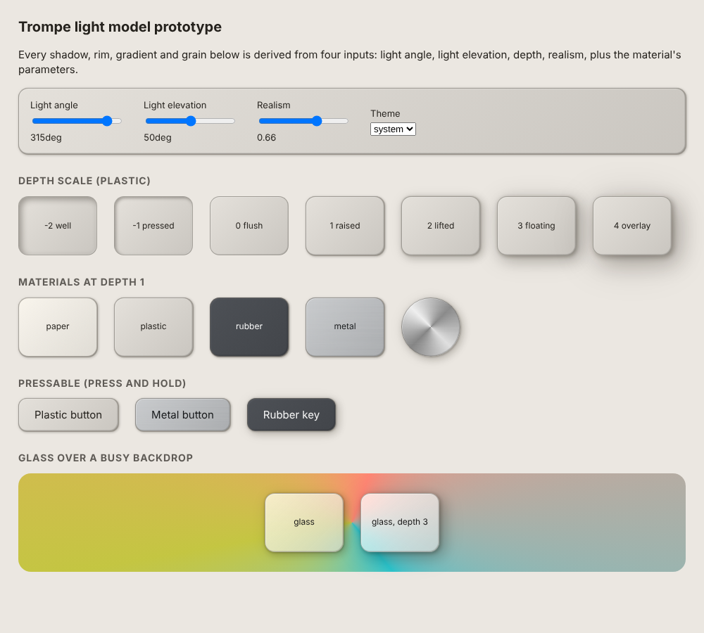
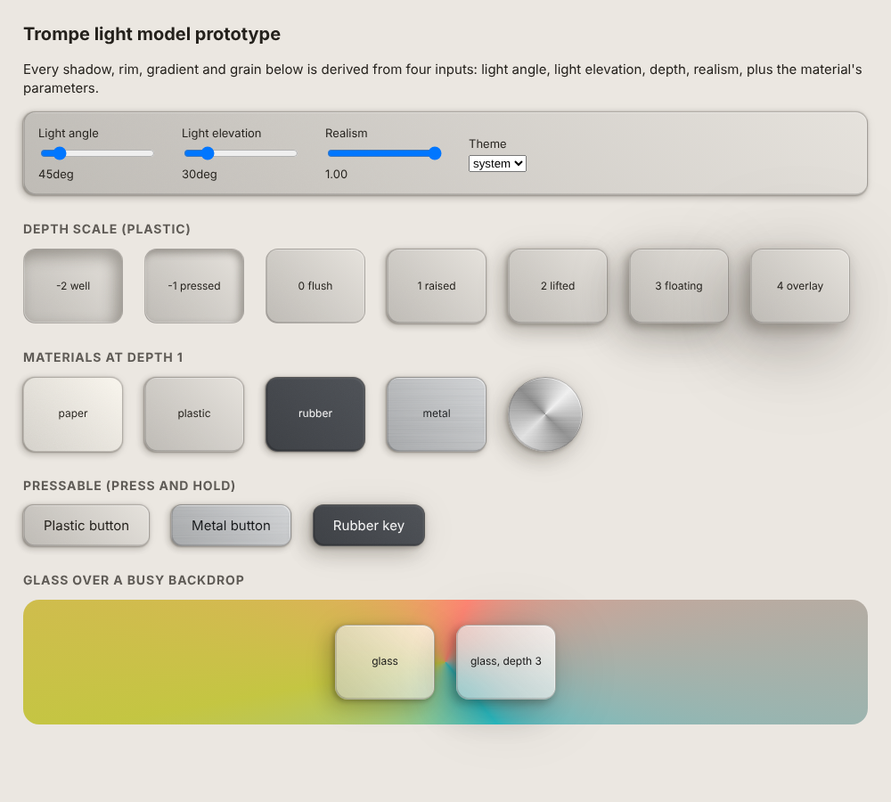
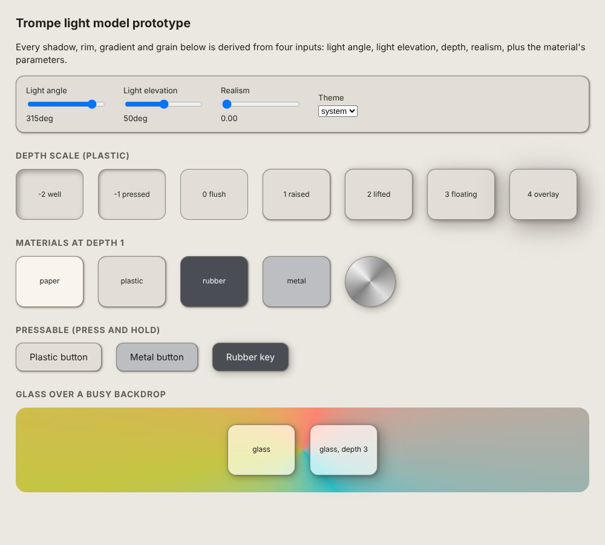
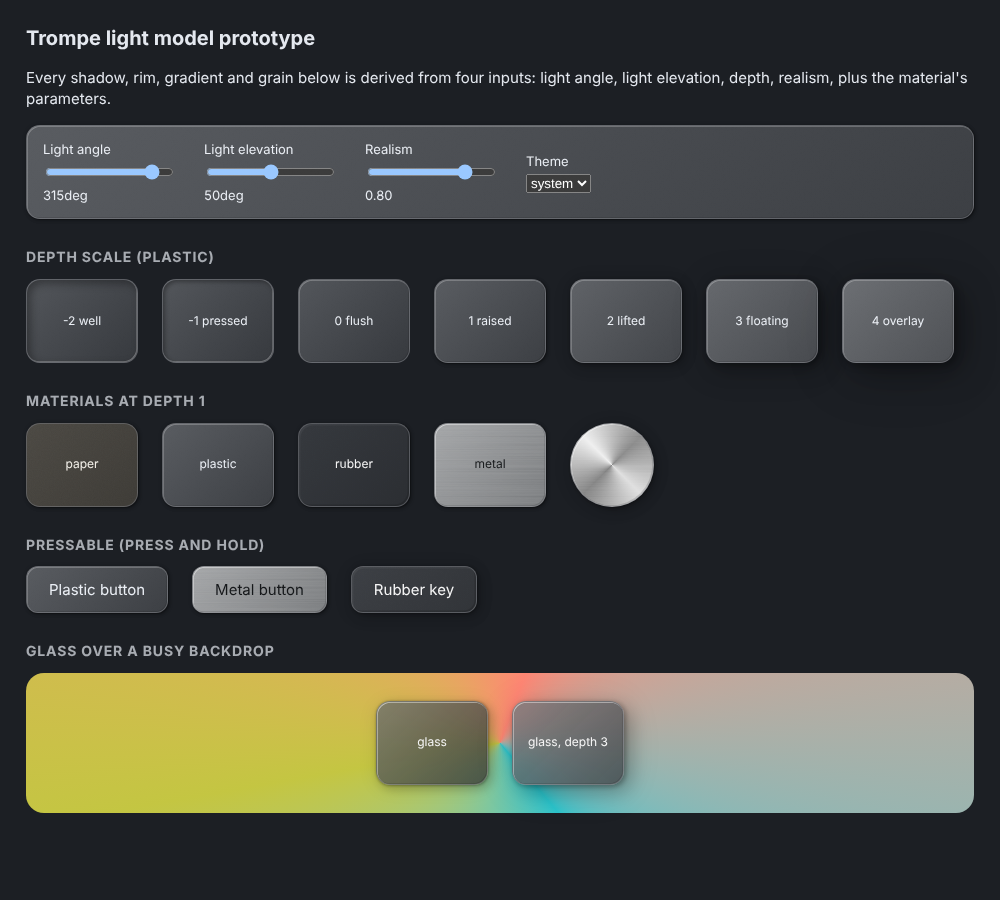

# Trompe design direction

Status: proposal, 2026-11-14. Owner: research thread. Consumers: the core foundation package and every component author (human or agent).

This document sets the visual and technical direction for Trompe: what "modern skeuomorphism" means here, how materials, depth and light are modelled, how tokens are named, which accessibility traps we design around, and which stack we build on. A working CSS prototype of the light model lives in [`prototypes/light-model.html`](prototypes/light-model.html).

## TL;DR: the decisions

1. **Appearance is physics with a tiny parameter set.** Every surface is rendered from four global inputs (light angle, light elevation, depth, realism) plus one material's parameters. Components never hand-write shadows or gradients. This is what lets an agent assemble a screen that is consistent by construction.
2. **Materials are parameter bundles, components are geometry.** `material` changes what a thing is made of, never its shape or behaviour. Core set: `paper`, `plastic`, `rubber`, `metal`, `glass`. Later: `leather`, `wood`, `fabric`, plus an `emissive` layer for LEDs and displays.
3. **One light per scene.** `--tr-light-angle` (0deg = light from the top, clockwise, same convention as CSS gradients) and `--tr-light-elevation`. Shadow and highlight offsets are computed with CSS `sin()`/`cos()`, so every component agrees on where the light is. Overridable per subtree.
4. **Depth is an integer from -2 to 4**, with names: well, pressed, flush, raised, lifted, floating, overlay. Shadow size grows non-linearly so each level reads distinctly.
5. **Realism is a dial, not a theme.** `realism="flat|soft|tactile|real"` maps to `--tr-realism` 0, 0.33, 0.66, 1. It scales gradient strength, specular, grain and bevel. The same markup goes from subtle tactile depth to full material realism.
6. **Accessibility is part of the model, not a mode.** Every interactive boundary carries a real 3:1 edge (never shadow-only), state is never shown by depth alone, and forced colors, reduced motion, reduced transparency and increased contrast each have a defined fallback.
7. **Stack:** Lit 3 + strict TypeScript, W3C DTCG 2025.10 tokens compiled to CSS custom properties, `custom-elements.json` via the CEM analyzer, generated `llms.txt`, Playwright + axe for tests, native `input`/`change` events so React 19, Vue and Svelte need no wrappers.

---

## 1. Prior art and what we take from it

| Era / system | What it got right | What went wrong | Take for Trompe |
|---|---|---|---|
| Classic skeuomorphism (iOS 1-6, ~2007-2013) | Affordances were obvious; materials taught people what was pressable | Bitmap-heavy, inconsistent light, ornamental textures (leather calendars) that carried no meaning | Materials must mean something (metal = precise control, paper = content, rubber = big physical action) |
| Flat / Material Design (2013-2014 onward) | Material's elevation system with a **key light + ambient light** is the closest prior art for our light model; systematic tokens | Affordance loss; everything looks clickable or nothing does | Keep Material's key + ambient split and elevation tiers; add a movable light and real materials |
| Neumorphism (2019-2020) | Soft, cohesive, tactile | Same-colour-as-background shapes fail WCAG 1.4.11 non-text contrast; pressed vs unpressed is invisible to many users; collapses in dark mode | Our `soft` realism level is neumorphism done right: same softness, but a real 3:1 edge and a second state cue |
| Glassmorphism (2020-2021) and Apple Liquid Glass (2025) | Depth through translucency; context stays visible | Text contrast on glass measured far below WCAG minimums in testing; Reduce Transparency only dulls the effect; refraction needs SVG filters and costs GPU | Glass is opt-in, never under body text by default, collapses to opaque under `prefers-reduced-transparency` and `prefers-contrast: more` |
| Hardware-inspired "new tactile" UIs (2023-2026) | Knobs, keys, LEDs, labelled panels; delight from precise detail | Often inaccessible custom controls (drag-only knobs, tiny switches) | Physical controls follow ARIA APG patterns (knob = slider), with keyboard and target-size rules |

Component library prior art:

- **Shoelace / Web Awesome** (Lit, now 3.x as Web Awesome): proves Lit + `::part()` + CSS custom property theming works across frameworks; ships a CEM and an `llms.txt` in its npm package. We copy the shape of that API surface.
- **Material Web** (Lit): three-tier token naming (`ref` / `sys` / `comp`). We adopt the tiers, with simpler names.
- **Spectrum Web Components, FAST**: show the cost of a too-large API surface. Our attribute vocabulary stays small and enumerable.

## 2. The rendering model

```
appearance = f(light angle, light elevation, depth, realism, material params)
```

Only the left-hand inputs are public. Everything a component draws is derived inside one shared surface recipe that the foundation package owns. Component authors pick a `material` and a `depth`; they do not write `box-shadow`.

### 2.1 Light model

| Token | Type (`@property`) | Default | Meaning |
|---|---|---|---|
| `--tr-light-angle` | `<angle>`, inherits | `315deg` (top-left) | Direction the light comes **from**. 0deg = top, clockwise, same convention as `linear-gradient()` |
| `--tr-light-elevation` | `<angle>`, inherits | `50deg` | Height of the light above the surface. Lower = longer shadows |
| `--tr-light-color` | `<color>` | warm white | Tints highlights (optional, `real` only) |

Derived inside the surface recipe (private `--_` variables):

```css
--_dx: calc(-1 * sin(var(--tr-light-angle)));   /* unit vector away from the light */
--_dy: cos(var(--tr-light-angle));
--_len: clamp(0.3, calc(cos(var(--tr-light-elevation)) / sin(var(--tr-light-elevation))), 3); /* cot(elev) */
--_off: calc(pow(var(--_d), 1.6) * var(--_len) * var(--tr-depth-unit));
```

Each raised surface gets three outer shadows (contact, key, ambient) and two inset rims (specular on the lit edge, dark rim on the far edge). Gradients run at `calc(var(--tr-light-angle) + 180deg)`. Rotating the one angle re-lights the whole page, which the prototype demonstrates.

Rules:

- **One light per scene.** A subtree may override the angle (for example a rotated device mock), but components must never set their own.
- **Pressed moves away from the light.** On `:active`, depth drops to -1 and the face translates 1px along (`--_dx`, `--_dy`).
- **Dark scenes light by lift, not shadow.** The prototype showed shadows nearly vanish on dark canvases. In dark themes each depth level also lightens the face (`--tr-lift`, about 4% per level) and the lit rim carries the depth cue, as Material does with elevation overlays.
- **Device-orientation light** (gyroscope parallax) is an opt-in enhancement, off under `prefers-reduced-motion`.

### 2.2 Depth scale

| Value | Name | Typical use | Rendering |
|---|---|---|---|
| -2 | `well` | Text inputs, slider tracks, meters | Deep inset shadow on the lit side |
| -1 | `pressed` | Active button, "on" latching key | Shallow inset |
| 0 | `flush` | Inline content, table cells, toolbars on a panel | Edge only |
| 1 | `raised` | Buttons, cards, switches | Contact + key + ambient |
| 2 | `lifted` | Hover, dragged item, knob | |
| 3 | `floating` | Menus, popovers, tooltips | |
| 4 | `overlay` | Dialogs, sheets | |

Rules for agents and the checker: a child's depth is relative to its parent surface; interactive states move one step (`hover` +1, `active` to -1); never more than three distinct positive depths on one screen.

### 2.3 Realism dial

| `realism` | `--tr-realism` | Looks like | What is on |
|---|---|---|---|
| `flat` | 0 | Clean flat UI with honest borders | Edge, one soft shadow for depth ≥ 1 |
| `soft` | 0.33 | Neumorphic softness, done accessibly | + light falloff gradient, rims |
| `tactile` (default) | 0.66 | Modern tactile hardware | + specular, bevels, faint grain |
| `real` | 1 | Full material realism | + full grain/anisotropy, conic metal, glass blur, tinted light |

Grain opacity scales with realism squared, so it only becomes visible near `real`. `prefers-contrast: more` caps realism at `soft`. The prototype shows `flat` is still a complete, usable UI.






## 3. Material taxonomy

A material is a fixed bundle of parameters, loosely modelled on PBR:

| Parameter | Token suffix | Range | Effect |
|---|---|---|---|
| Base colour | `-base` | colour | Face colour (theme aware) |
| Ink | `-ink` | colour | Text/icon colour **on this material**, contrast-checked ≥ 4.5:1 against the base and both gradient extremes |
| Roughness | `-roughness` | 0..1 | Softens and widens highlights |
| Metalness | `-metalness` | 0..1 | Tints reflections with the base, boosts contrast bands |
| Specular | `-specular` | 0..1 | Highlight strength |
| Translucency | `-translucency` | 0..1 | Backdrop show-through (glass only today) |
| Grain | `-grain`, `-grain-image`, `-grain-angle` | 0..1, image, angle | Noise strength, tile, anisotropy direction |
| Bevel | `-bevel` | length | Rim width |
| Edge | `-edge` | colour | The 3:1 boundary colour |

| Material | Real-world cues | CSS technique | Use for | Risk |
|---|---|---|---|---|
| `paper` | Matte, fibrous, soft contact shadow | Fractal-noise SVG tile, no rim | Cards, sheets, notes, content | Low |
| `plastic` | Uniform, soft falloff, crisp rim when glossy | Gradient + inset rim | Buttons, switches, panels (default) | Low |
| `rubber` | Very matte, rounded, deep soft shadow | Wide bevel, low specular | Big keys, pads, grips | Dark base needs light ink |
| `metal` | Brushed streaks or spun circles, sharp bands | Anisotropic noise (`baseFrequency` x ≪ y), `conic-gradient` from the light angle for knobs | Knobs, sliders, bezels, precise controls | Light ink on metal fails in dark mode, so ink is per material |
| `glass` | Translucent, frosted, bright edge | `backdrop-filter: blur() saturate()`, inner highlight | Overlays, toolbars over imagery | Text contrast varies with what is behind; GPU cost |
| `leather` (later) | Pebbled grain, stitching | Noise + dashed inset border | Headers, panels | Ornamental; use sparingly |
| `wood` (later) | Directional grain | Layered `repeating-linear-gradient` + turbulence | Panels, trays | Busy under text |
| `fabric` (later) | Woven texture | Two-axis noise | Speaker grilles, backgrounds | Busy under text |
| `emissive` (layer) | LEDs, backlit labels, LCDs | Glow via `box-shadow` + `color-mix`; not light-dependent | State indicators, meters | Never the only state cue |

Textures are generated SVG (`feTurbulence`) data URIs, a few hundred bytes each, rendered as a separate pseudo-element layer so the checker can keep grain out from under text. No bitmaps in the core.

## 4. Token naming

Tokens are authored once in W3C DTCG 2025.10 JSON and compiled to CSS custom properties, a typed JSON export and docs. One rule for every name:

```
--tr-{category}-{concept}[-{variant}][-{state}]
```

Lowercase kebab case, nouns before modifiers, numeric scales where order matters, t-shirt sizes only for `size`.

| Category | Examples |
|---|---|
| `light` | `--tr-light-angle`, `--tr-light-elevation`, `--tr-light-color` |
| `realism` | `--tr-realism` |
| `depth` | `--tr-depth` (per element), `--tr-depth-unit` |
| `material` | `--tr-material-metal-base`, `--tr-material-metal-ink`, `--tr-material-glass-translucency` |
| `color` | `--tr-color-canvas`, `--tr-color-ink`, `--tr-color-edge`, `--tr-color-accent`, `--tr-color-danger`, `--tr-color-focus` |
| `space` | `--tr-space-0` … `--tr-space-12` |
| `radius` | `--tr-radius-0` … `--tr-radius-5`, `--tr-radius-round` |
| `font` | `--tr-font-family-ui`, `--tr-font-size-2`, `--tr-font-weight-strong` |
| `motion` | `--tr-motion-duration-press`, `--tr-motion-easing-spring` |
| Component | `--tr-button-radius`, `--tr-knob-size` (only for genuine per-component knobs) |

Tiers (after Material Web, simplified): **reference** palette values (`--tr-ref-sand-500`) are never used by components; **system** tokens above are the public theming surface; **component** tokens default to system tokens. Private implementation variables inside shadow roots start with `--_` and are never documented.

Theme-dependent colours use `light-dark()`. Theme-dependent **non-colour** values (for example `--tr-lift`) cannot, because `light-dark()` only accepts colours; they use the `prefers-color-scheme` media query plus the `data-tr-theme` attribute. Agreed with the foundation thread: `data-tr-theme="light|dark"` on any ancestor, default follows the system.

Public attribute vocabulary (closed enums, so agents and the checker can validate):

| Attribute | Values |
|---|---|
| `material` | `paper` `plastic` `rubber` `metal` `glass` |
| `depth` | `-2` … `4` |
| `realism` | `flat` `soft` `tactile` `real` |
| `tone` | `neutral` `accent` `danger` |
| `size` | `sm` `md` `lg` |

## 5. Accessibility pitfalls and the rule for each

| Pitfall | Where it bites | Trompe rule |
|---|---|---|
| Shadow-only boundaries (WCAG 1.4.11, 3:1) | Neumorphism, `flat`/`soft` | Every interactive component draws `--tr-color-edge` (≥ 3:1 vs its surroundings) or has a ≥ 3:1 fill difference. Shadows are decoration, never the boundary |
| State shown only by depth | Toggles, latching keys | Pressed/on states add a second cue: fill, icon, label or emissive indicator. Checked by the test suite |
| Text over gradient, grain or glass (1.4.3, 4.5:1) | `metal`, `glass`, `real` | Each material's `-ink` is checked against the base **and** both gradient extremes at `real`. Grain is excluded from text areas; glass gets a scrim token |
| Focus hidden by glow or depth (2.4.7, 2.4.11, 2.4.13) | All | Focus is an `outline` in `--tr-color-focus` with offset, never a shadow (shadows vanish in forced colours) |
| Forced colours (Windows High Contrast) | All | `box-shadow` and gradient backgrounds are removed by the browser, so every surface keeps a `1px solid` border (transparent normally, system colour in forced colours); states use `Highlight`, `ButtonText`, `GrayText` |
| Motion (2.3.3, vestibular) | Press springs, parallax, gyroscope light | `prefers-reduced-motion: reduce` makes state changes instant and disables parallax and orientation light |
| Transparency | `glass` | `prefers-reduced-transparency: reduce` (Chromium only today, not Baseline) and `prefers-contrast: more` turn glass opaque |
| Increased contrast | All | `prefers-contrast: more` caps realism at `soft` and strengthens edges |
| Tiny physical controls (2.5.8 target size) | Switches, knobs, keys | Minimum 24px hit area always, 44px default for `md` |
| Drag-only controls (2.5.7) | Knobs, sliders, faders | Knob = APG slider: arrow keys, Page Up/Down, Home/End, `aria-valuetext`, plus click/tap alternatives |
| Dark mode depth collapse | Dark themes | Depth via lift and lit rims (section 2.1) |

## 6. Recommended stack

| Concern | Choice | Why |
|---|---|---|
| Components | Lit 3 (OpenJS Foundation), strict TypeScript | Small, standards-based, proven by Web Awesome and Material Web; reactive properties map 1:1 to attributes |
| Styling | Shadow DOM CSS + `::part()`, `@layer` for consumer overrides, custom properties pierce the shadow boundary for theming | Encapsulated but themeable |
| CSS features (Baseline) | `@property`, trig functions, `pow()`, `color-mix()`, `oklch()`, `light-dark()`, container size queries, `:has()`, `@layer`, popover | All Baseline across Chrome, Firefox and Safari by 2024-2025 |
| CSS features (enhancement only) | `if()` (Chromium only), container style queries, `prefers-reduced-transparency`, `corner-shape` | Always with a plain fallback declaration first |
| Forms | `ElementInternals` form association; fire native `input`/`change` (bubbling, composed) | React 19, Vue and Svelte bind them with no wrappers (decision taken with the foundation thread) |
| Tokens | DTCG 2025.10 JSON → small build script → CSS, typed JSON, docs | First stable spec (Oct 2025); one source of truth |
| Build | tsc + esbuild for the library; Vite for showcase/examples | Fast, minimal |
| Tests | Playwright (component + visual regression across light angles, realism levels, themes, forced colours), axe-core | Visual regression is the only way to catch broken light |

### Agent-readable surface

This is the part that makes Trompe usable by a coding agent with no human tuning:

1. **`custom-elements.json`** from `@custom-elements-manifest/analyzer`, driven by JSDoc (`@summary`, `@slot`, `@csspart`, `@cssprop`, `@fires`). Every attribute's enum lands in the manifest.
2. **`trompe.manifest.json`**: one generated file listing components, attributes with enums, materials with their parameters, depth names, tokens with types and defaults, and short usage recipes. This is the file an agent reads first.
3. **`llms.txt` + `llms-full.txt`** generated from the same sources (Web Awesome ships one in its package; coding agents and Context7-style indexes read them even though web crawlers mostly do not).
4. **Editor data**: `vscode.html-custom-data.json` and JetBrains `web-types.json`, plus JSX/Vue/Svelte type declarations generated from the manifest.
5. **`trompe check`**: a deterministic linter an agent runs on its output: unknown elements/attributes, invalid enum values, contrast of `material` × `tone` × theme combinations, depth rules (section 2.2), glass over glass, grain under text, missing labels. Machine-readable output so an agent can fix and re-run.
6. Later: an MCP server exposing the manifest and `check`.

## 7. Open questions (not blocking)

- Whether `tone` should tint materials (an accent-coloured plastic) or only apply emissive and edge colour. Recommendation: tint plastic and rubber only; metal and glass take tone through emissive accents.
- Refraction for `glass` at `real` (SVG displacement filters, Liquid Glass style) is possible but expensive and hurts legibility; defer until there is a performance budget.
- SSR via Declarative Shadow DOM (Lit SSR) is worth a spike once components stabilise.

## Sources

- W3C Design Tokens Community Group, [first stable spec 2025.10](https://www.w3.org/community/design-tokens/2025/10/28/design-tokens-specification-reaches-first-stable-version/) and [Format Module 2025.10](https://www.w3.org/community/reports/design-tokens/CG-FINAL-format-20251028/)
- [Web Awesome repository](https://github.com/shoelace-style/webawesome) (Shoelace 3, built on Lit); Web Awesome's [packaged llms.txt](https://cdn.jsdelivr.net/npm/@awesome.me/webawesome@3.6.0/dist/llms.txt)
- [CSS `if()` support](https://web-platform-dx.github.io/web-features-explorer/features/if) (Chromium only)
- [`prefers-reduced-transparency` on MDN](https://developer.mozilla.org/en-US/docs/Web/CSS/@media/prefers-reduced-transparency) (limited availability)
- Liquid Glass accessibility: [Infinum](https://infinum.com/blog/apples-ios-26-liquid-glass-sleek-shiny-and-questionably-accessible/), [Frontend Masters](https://frontendmasters.com/blog/?p=6644), [CSS WG thread](https://lists.w3.org/Archives/Public/public-css-archive/2025Jun/0336.html)
- llms.txt usage: [ppc.land adoption study](https://ppc.land/llms-txt-adoption-rises-8-8x-but-97-of-files-get-zero-ai-requests/), [Codex CLI and llms.txt](https://codex.danielvaughan.com/2026/06/06/llms-txt-specification-codex-cli-machine-readable-documentation-agent-context/)
- WCAG 2.2: 1.4.3, 1.4.11, 2.3.3, 2.4.7, 2.4.11, 2.4.13, 2.5.7, 2.5.8; ARIA APG slider pattern
